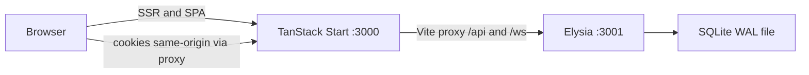

# Migrate Tasklane to Elysia, Better Auth, and Bun

Status: planned. Product surface stays the same (Boards, Lists, Cards, Labels, Members, Comments, Archive, Activity, Presence). Domain language in [`CONTEXT.md`](../../CONTEXT.md) stays.

This plan **contradicts ADR 0001** (Convex as the reactive backend), **ADR 0002** (Clerk as identity), and **ADR 0003** (Convex live queries and cron-swept presence). Those records stay as history. Implementation writes new ADRs that supersede them.

Chosen persistence: **SQLite + Drizzle**. Chosen frontend: **keep TanStack Start**; Elysia is a separate API process. Bun is the package manager and runtime for both.

## Target shape

Bun workspaces at the repo root (replace `app/`-only pnpm):

- [`app/`](../../app/) — existing TanStack Start UI. Drop Convex, Clerk, and pnpm. Use Bun as package manager and as the Vite/dev runtime.
- `api/` — new Elysia server on Bun: HTTP (Eden-typed), Better Auth, Drizzle + `bun:sqlite`, WebSocket topics.
- Root `package.json` workspaces `["app", "api"]`, single `bun.lock`. Delete [`app/pnpm-lock.yaml`](../../app/pnpm-lock.yaml) and [`app/pnpm-workspace.yaml`](../../app/pnpm-workspace.yaml).

Dev topology:



Vite in [`app/vite.config.ts`](../../app/vite.config.ts) proxies `/api` and `/ws` to `http://localhost:3001` so Better Auth session cookies stay first-party. Root scripts start both processes (`bun run dev`).

SQLite implication (accepted): **one API process**. In-memory Elysia/Bun pub-sub is enough. Multi-instance realtime would need Postgres or Redis later.

## Persistence: Drizzle + SQLite

Map [`app/convex/schema.ts`](../../app/convex/schema.ts) 1:1 into Drizzle tables in `api/src/db/schema.ts`, plus Better Auth tables (`user`, `session`, `account`, `verification`).

- PKs: text ULIDs (replace Convex `Id<'boards'>`).
- Foreign keys with `onDelete: 'cascade'` for board teardown (today [`boards.remove`](../../app/convex/boards.ts) does this in application code).
- Indexes matching Convex (`by_boardId`, `by_list_and_position`, and the rest).
- Enable WAL, `foreign_keys = ON`, and a busy timeout on the `bun:sqlite` connection.
- Domain `userId` columns reference Better Auth `user.id`. Drop `tokenIdentifier` / Clerk sync in [`app/convex/users.ts`](../../app/convex/users.ts) and [`useHomeUserSync`](../../app/src/features/auth/hooks/use-home-user-sync.ts).
- Presence sweep: `setInterval` in the API process (replace [`app/convex/cron.ts`](../../app/convex/cron.ts)).

No Convex data export — treat this as a greenfield database. Use `drizzle-kit generate` / `migrate` for schema.

## Auth: Better Auth

Follow the current [Elysia integration](https://better-auth.com/docs/integrations/elysia): `drizzleAdapter(db, { provider: "sqlite" })`, email + password (same product as today), `.mount(auth.handler)`, CORS credentials, and an Elysia macro that calls `auth.api.getSession({ headers })` so routes can use `{ auth: true }`.

Client: `better-auth/react` `createAuthClient` with `basePath: '/api/auth'`.

UI work in `app/`:

- Remove `ClerkProvider` / `ConvexProviderWithClerk` from [`app/src/routes/__root.tsx`](../../app/src/routes/__root.tsx).
- Replace [`app/src/routes/sign-in.$.tsx`](../../app/src/routes/sign-in.$.tsx) with real `/sign-in` and `/sign-up` forms (Clerk hosted UI goes away).
- Replace `useAuth` / `useConvexAuth` skip-query sequencing in [`use-dashboard-boards.ts`](../../app/src/features/dashboard/hooks/use-dashboard-boards.ts), [`use-board-page.ts`](../../app/src/features/board/hooks/use-board-page.ts), [`home.tsx`](../../app/src/routes/home.tsx), and [`index.tsx`](../../app/src/routes/index.tsx) with Better Auth session: loading, then unauthenticated, then data.
- Keep the product rule: **reads return null/`[]` when unauthenticated; writes return 401**. List/get handlers must not throw in a way that blows the error boundary during session handshake.

Trusted origins: web origin. Env: `BETTER_AUTH_SECRET`, `BETTER_AUTH_URL`.

## HTTP API: port Convex modules, keep behavior

Elysia plugins under `api/src/modules/` mirroring [`app/convex/*.ts`](../../app/convex/) (`boards`, `lists`, `cards`, `labels`, `members`, `assignees`, `comments`, `activity`, `presence`). Port handlers, validation, owner-vs-member checks from [`auth_helpers.ts`](../../app/convex/auth_helpers.ts), and **anchor-based reorder** from [`lists.reorder`](../../app/convex/lists.ts) / [`cards.reorder`](../../app/convex/cards.ts) (that part of ADR 0003 stays).

Export `type App = typeof app` from `api/src/index.ts`. The web app uses `@elysiajs/eden` `treaty<App>` against same-origin `/api` — this replaces `convex/_generated/api`.

Type IDs in [`board.types.ts`](../../app/src/features/board/types/board.types.ts) and dashboard types switch from Convex `Doc`/`Id` to Eden response types (or a thin shared alias exported from `api` if needed).

## Realtime: rooms + TanStack Query

Do not re-run arbitrary queries on every write. After a successful mutation, publish to Bun topic `board:{boardId}`:

```ts
{ type: 'board.changed', keys: ['lists', 'cards', 'activity'], boardId }
```

Presence can send the viewer snapshot (small).

Web:

- Add `@tanstack/react-query`.
- One `useBoardSocket(boardId)` that Eden-subscribes to `/ws/boards/:boardId` (cookie session on upgrade; reject non-members).
- On event, `queryClient.invalidateQueries` for those keys.
- Keep existing optimistic DnD/rename logic in [`use-card-actions.ts`](../../app/src/features/board/hooks/use-card-actions.ts) / [`use-list-actions.ts`](../../app/src/features/board/hooks/use-list-actions.ts), rewriting `localStore.setQuery` to `queryClient.setQueryData`.
- Presence: keep 20s heartbeat + visibility in [`use-board-presence.ts`](../../app/src/features/board/hooks/use-board-presence.ts); also upsert on WebSocket `open` and let `close` + sweep evict. Thresholds stay [`PRESENCE_ACTIVE_THRESHOLD_MS`](../../app/convex/constants.ts) (30s) and 60s sweep.

Paginated activity and comments: HTTP cursor pagination (replace Convex `usePaginatedQuery`).

## Work sequence

1. Add root Bun workspaces (`app` + `api`), switch scripts/lockfile from pnpm, proxy `/api` and `/ws` in Vite.
2. Create Drizzle schema (domain + Better Auth), `bun:sqlite` WAL, migrations.
3. Mount Better Auth on Elysia; session macro; email/password; cookie CORS/proxy.
4. Port Convex queries/mutations to Elysia plugins with the same access rules and anchor reorder.
5. Board-topic WebSocket, publish after writes, presence heartbeat + in-process sweep.
6. Replace Clerk/Convex in Start: Eden + TanStack Query, auth pages, optimistic updates, sockets.
7. Port API tests to `bun:test`; supersede ADRs; update `AGENTS.md` and `README.md`.

## Tests, docs, commands

- Port `app/convex/*.test.ts` to `api` with `bun:test` against a temp SQLite file (drop `convex-test`).
- Keep frontend unit tests; run with `bun test` where practical.
- Rewrite [`AGENTS.md`](../../AGENTS.md), [`app/AGENTS.md`](../../app/AGENTS.md), and [`README.md`](../../README.md): Bun not pnpm; remove Convex auth handshake notes; document API + web scripts and env vars.
- New ADRs: stack (Start + Elysia + Drizzle/SQLite + shadcn + Zod/TypeBox), Better Auth, realtime (WebSocket topics + Query + heartbeat presence).
- Verification: `bun run typecheck` then lint/format from `app/`; `bun test` in `api`; browser pass of sign-up, board CRUD, drag-and-drop, comments, archive, members, activity, presence avatars on two sessions.

## Out of scope

- Migrating existing Convex cloud data.
- Multi-region / multi-process realtime.
- Changing board UI or domain terms.
